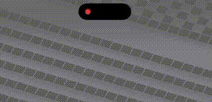

<div align="center">

  <br>

  <a href="https://github.com/Thanking157/IslandSpark">
    
  </a>

  <h1>IslandSpark</h1>

  <p><b>Native Dynamic Island for macOS.</b></p>
  <p>by Thanking157</p>

  <p>
    An experimental project that enables macOS's native Dynamic Island on Mac :3
  </p>

  <p>
    Enable macOS's built-in Dynamic Island interface using LLDB!<br>
    No additional app installation or permanent changes to system preferences required w
  </p>

  [GitHub Repository](https://github.com/Thanking157/IslandSpark) · [Original Project](https://github.com/habildem/native-mac-island-experiment) · [繁體中文](README.md)

</div>

# Known Compatibility :D

The original GitHub project's README documents a successful test on macOS 27.3 Beta, Build 26C5035r.

My M4 MacBook Air also successfully displayed the music Dynamic Island on this Build. I'm not sure whether it works on other macOS versions w

# By the Way w

I asked ChatGPT Codex to help me make a version that can be executed just by opening it awa

After downloading and extracting the ZIP, simply run `啟動原生動態島.command` and you're good to go w

But don't forget to disable SIP =.=

Oh, and when running it, you may be asked for an administrator password and need to follow the on-screen instructions :D

# 1. Download and Check the Project w

Download and extract the project, then make sure the folder contains:

```text
README.md
manifest.json
startup_lldb.py
```

Next, run the following commands in Terminal:

```sh
sw_vers -buildVersion
uname -m
csrutil status
xcrun --find lldb
shasum -a 256 /System/Library/CoreServices/MenuBarAgent.app/Contents/MacOS/MenuBarAgent
```

Make sure the Build, SHA-256, and UUID all match `manifest.json`, and the architecture must be `arm64`.

If anything doesn't match, stop immediately. Memory addresses may change after macOS updates, so don't force old addresses to work awa

# 2. Disable SIP

If SIP shows `enabled`:

Shut down → Press and hold the power button → "Options" → "Continue"

From the menu bar, open "Utilities" → "Terminal".

Run:

```sh
csrutil disable
```

Then run:

```sh
reboot
```

After returning to the normal desktop:

```sh
csrutil status
```

Make sure SIP is disabled and the status shows `disabled`.

# 3. Suspend MenuBarAgent and Attach LLDB

Run the following command in a normal Terminal:

```sh
sudo launchctl debug gui/$(id -u)/com.apple.MenuBarAgent --start-suspended
```

After seeing `Service configured for next launch.`:

Run:

```sh
launchctl kickstart -k gui/$(id -u)/com.apple.MenuBarAgent
xcrun lldb -n MenuBarAgent
```

The menu bar may temporarily stop responding. When LLDB successfully attaches, it should show MenuBarAgent stopped near `dyld_start`, with `SIGSTOP` as the stop reason.

# 4. Load the Experimental Script w

At the `(lldb)` prompt, enter the following command.

Replace the path with the absolute path on your own computer:

```text
command script import /Users/你的帳號/Downloads/native-mac-island-experiment-main/startup_lldb.py
```

If successful, you should see a message similar to:

```text
Startup HUD breakpoints installed. Continue; inspect startup_lldb.hits before claiming success.
```

Then you can continue.

But if an error occurs, stop first and follow the recovery instructions in the README.

# 5. Start and Verify Dynamic Island w

Enter the following command in LLDB:

```text
continue
```

Wait for the menu bar to recover, then play some music or use an existing Live Activity to check whether Dynamic Island appears. Only consider it successful if you can actually see it on the screen.

Next, press `Ctrl-C`, then enter:

```text
script print(startup_lldb.hits)
```

Make sure both `gate` and `flags` are greater than `0`.

# 6. Exit LLDB While Keeping Dynamic Island Active w

After confirming that it works, enter the following commands in order at the `(lldb)` prompt:

```text
breakpoint delete --force
process detach
quit
```

This allows `MenuBarAgent` to continue running.

If you want to keep Dynamic Island active, do not run `launchctl kickstart -k ...`.

Also, do not log out or restart your Mac (this is very important awa

As long as `MenuBarAgent` doesn't restart, the Dynamic Island effect can remain active :D
