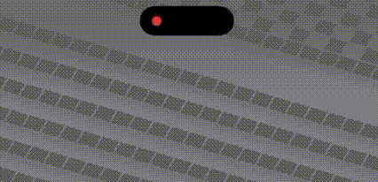

<div align="center">

  <br>

  <a href="https://github.com/Thanking157/IslandSpark">
    
  </a>

  <h1>IslandSpark</h1>

  <p><b>Native Dynamic Island for macOS.</b></p>
  <p>by Thanking157</p>

  <p>
    一個讓 Mac 啟用 macOS 原生動態島的實驗專案 :3
  </p>

  <p>
    透過 LLDB 啟用 macOS 內建的動態島介面！<br>
    不需要額外安裝 App，也不會永久修改系統偏好設定 w
  </p>

  [GitHub 專案](https://github.com/Thanking157/IslandSpark) · [原始專案](https://github.com/habildem/native-mac-island-experiment) · [English](README.en.md)

</div>

# 已知相容性:D
這個Github專案 README 記錄的成功案例是 macOS 27.3 Beta、Build 26C5035r  
我的 M4 MacBook Air 也在這個 Build 上成功顯示音樂動態島不確定其他MacOS能否成功w

# 順帶一提w
我請ChatGPT Codex 幫我製作了這個打開就可以執行的版本awa  
下載好Zip解壓縮執行 `啟動原生動態島.command` 就ok了w  
但別忘了關閉SIP =.=  
喔對了w執行時可能會要求管理員密碼並需要依畫面提示完成:D

# 1. 下載並檢查專案w
下載並解壓縮專案，確認資料夾內有：

```text
README.md
manifest.json
startup_lldb.py
```
接著Terminal 執行：

```sh
sw_vers -buildVersion
uname -m
csrutil status
xcrun --find lldb
shasum -a 256 /System/Library/CoreServices/MenuBarAgent.app/Contents/MacOS/MenuBarAgent
```

確認 Build、SHA-256、UUID 都跟 manifest.json 一致，架構要是 arm64  
如有任何一項不符請停止。macOS 更新後位址可能改變不能用舊位址硬用awa

# 2. 關閉 SIP
若 SIP 顯示 `enabled`  
關機 → 長按電源鍵 →「選項」→「繼續」  
從選單列開啟「工具程式」→「終端機」

執行：

```sh
csrutil disable
```

接著執行：

```sh
reboot
```

回到一般桌面後：

```sh
csrutil status
```

必須顯示 SIP 已停用確認 SIP 是 `disabled`

# 3. 暫停 MenuBarAgent 並附加 LLDB
在一般 Terminal 執行：

```sh
sudo launchctl debug gui/$(id -u)/com.apple.MenuBarAgent --start-suspended
```

看到 `Service configured for next launch.` 後  
接著執行：

```sh
launchctl kickstart -k gui/$(id -u)/com.apple.MenuBarAgent
xcrun lldb -n MenuBarAgent
```

選單列可能短暫停止回應成功附加時LLDB 應顯示 MenuBarAgent 停在 dyld_start 附近原因為 SIGSTOP

# 4. 載入實驗腳本w
在 LLDB 的 (lldb) 提示符輸入  
請將路徑換成自己電腦上的絕對路徑：

```text
command script import /Users/你的帳號/Downloads/native-mac-island-experiment-main/startup_lldb.py
```

成功時應看到類似訊息：

```text
Startup HUD breakpoints installed. Continue; inspect startup_lldb.hits before claiming success.
```

就可以繼續

but如果出錯先停止並依 README 的復原方式處理

# 5. 啟動並確認動態島w
在 LLDB 輸入：

```text
continue
```

等待選單列恢復並用正在播放的音樂或現有 Live Activity 確認動態島是否出現畫面上看得到才算確認成功

接著按 Ctrl-C 後：

```text
script print(startup_lldb.hits)
```

確認 `gate` 和 `flags` 都 > 0

# 6. 關閉 LLDB同時保留動態島w
確認成功後，在 (lldb) 依序輸入：

```text
breakpoint delete --force
process detach
quit
```

這會讓 `MenuBarAgent` 繼續執行

若要保留動態島不要執行 `launchctl kickstart -k ...`  
也不要登出或重新開機 (這很重要awa  
只要 `MenuBarAgent` 沒有重啟動態島效果就能繼續保留:D
